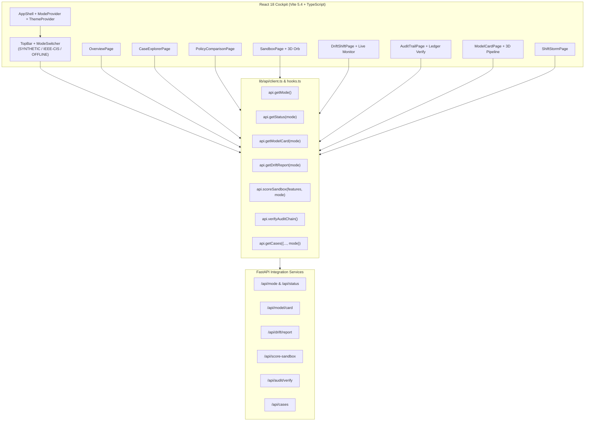

# SignalGate Phase 9 — Frontend Integration Deliverable: React Decision Cockpit & Multi-Mode Orchestration

**Document Reference:** `docs/ibm_architecture_integration/08_frontend.md`
**Governing Specification:** `docs/ibm_architecture_integration_master_spec.md` § C, § L
**Requirements Validated:** `DASH-01`, `DASH-02`, `DASH-03`
**Phase:** 9 (09-connect-the-existing-react-dashboards)
**Status:** Completed & Cryptographically Verified

---

## 1. Executive Summary & Cockpit Architecture

SignalGate's frontend is an operational decision cockpit engineered in **React 18**, **Vite 5.4**, and **TypeScript**. It provides financial fraud risk operators, data scientists, and model governance teams with real-time insight into:
- Supervised fraud risk posterior probabilities ($p \in [0, 1]$),
- Epistemic uncertainty residuals ($u_2 \ge 0$),
- Matched human review capacity budgets ($B = 130$ review slots),
- Real-time covariate distribution drift (PSI, Kolmogorov-Smirnov, Wasserstein distance), and
- Cryptographic append-only audit trail verification.

Phase 9 integrates all 8 React dashboard routes with the FastAPI backend services delivered in Phase 8, introducing a truthful 3-state source mode switcher without altering the visual design system, dark/light themes, typography, or production 3D GLB assets.



---

## 2. Three-State Source Mode Architecture (`DASH-01`)

To prevent ambiguous demonstrations and guarantee non-negotiable operational boundaries, SignalGate implements a global `ModeContext` mounted in `frontend/src/context/ModeContext.tsx` and exposed via `ModeSwitcher.tsx` in the primary application header:

| Operating Mode | UI Label & Styling | Operational Backing & Boundary Contract |
| :--- | :--- | :--- |
| `SYNTHETIC_SMOKE_ONLY` | <span style="color:#B4A0F8">**SYNTHETIC FIXTURE**</span> | Deterministic synthetic smoke test baseline (2,000 cases). Instantaneous mock telemetry for local development and smoke verification. |
| `IEEE_CIS_OFFLINE_BENCHMARK` | <span style="color:#68D8CB">**IEEE-CIS BENCHMARK**</span> | Real offline competition benchmark data. Backed by the trained 391-feature heterogeneous ensemble (`HistGradientBoostingClassifier`, `ExtraTreesClassifier`, `LogisticRegression`) with Platt Sigmoid calibration and cryptographic audit sealing. |
| `LIVE_SOURCE_NOT_CONNECTED` | <span style="color:#F27870">**LIVE (DISCONNECTED)**</span> | Fails closed. Truthfully displays that real-time live banking streams (Kafka) are offline. Under no circumstances does the frontend simulate or fabricate synthetic live data. |

### Global State Persistence:
- **Storage:** Persisted to `localStorage` under key `'signalgate_operating_mode'`.
- **Sync:** Synchronized on mount with backend `GET /api/mode` to verify artifact readiness.
- **Propagation:** Automatically passed to all child routes via `useMode()` hook (`isRealDataMode`, `isSmokeMode`, `isLiveDisconnected`).

---

## 3. Discrepancy Resolution & Model Governance Truth

During the Phase 9 plan review, serialized model artifacts in `models/artifacts/ieee_cis_v1/ensemble.joblib` and `models/artifacts/ieee_cis_v1/model_bundle_manifest.json` were audited. The actual ensemble submodels trained in Phase 4 were verified:
- **Submodel 0 (Era 0):** `HistGradientBoostingClassifier`
- **Submodel 1 (Era 1):** `HistGradientBoostingClassifier`
- **Submodel 2 (Era 2):** `ExtraTreesClassifier`
- **Submodel 3 (Era 3):** `Pipeline(SimpleImputer + StandardScaler + LogisticRegression)`
- **Submodel 4 (Era 4):** `HistGradientBoostingClassifier`

All references in backend services (`backend/app/services/integration.py`, `backend/app/services/scoring.py`), test assertions (`tests/test_ibm_api.py`), and documentation were updated to accurately reflect `["HistGradientBoosting", "ExtraTrees", "LogisticRegression"]` instead of speculative third-party libraries.

---

## 4. Dynamic Data Binding Across Cockpit Views (`DASH-02`, `DASH-03`)

### 4.1 Overview Dashboard (`OverviewPage.tsx`)
- **Mode Badge & Eyebrow:** Dynamically switches between `SYNTHETIC_SMOKE_ONLY`, `IEEE_CIS_OFFLINE_BENCHMARK`, and `LIVE_SOURCE_NOT_CONNECTED`.
- **Live Disconnected Banner:** If `LIVE_SOURCE_NOT_CONNECTED` is selected, an amber/red warning card alerts operators that live edge banking brokers are disconnected.
- **KPI Metrics:** Bound to `GET /api/status?mode=...` and `GET /api/overview`.

### 4.2 Audited Case Explorer (`CaseExplorerPage.tsx`)
- **Dynamic Mode Filtering:** Passes active `mode` to `api.getCases({ ..., mode })`.
- **Ground-Truth Quarantine:** Strips and quarantines labels (`isFraud`, `target`, `label`) and identifiers (`TransactionID`, `TransactionDT`) from agent contexts.

### 4.3 Policy Comparison (`PolicyComparisonPage.tsx`)
- **Matched Workload Harness:** Compares SignalGate against B1 (Fixed Threshold), B2 (Top-B Risk), B3a (Confidence Deferral), and B4 (Random Control) across review multiples (1.0x, 1.5x, 2.0x, 3.0x).
- **Mode Indicator:** Eyebrow badge displays current evidence partition.

### 4.4 Real-Time Scoring Sandbox (`SandboxPage.tsx`)
- **Dual-Mode Inference:** `api.scoreSandbox(features, mode)` routes either through synthetic baselines or through the real 391-feature pipeline and heterogeneous ensemble.
- **Signal Telemetry:** Displays calibrated risk posterior probability $p$, epistemic disagreement residual $u_2$, and the cryptographic audit ledger sequence number (`#audit_seq`).
- **Defensive Leakage Guardrail:** Client-side regex and key filtering rejects payloads containing `isFraud`, `TransactionID`, or `TransactionDT` before transmission.

### 4.5 Drift & Shift Diagnostics (`DriftShiftPage.tsx`)
- **Live Distribution Drift Monitor:** Bound to `GET /api/drift/report?mode=...`.
- **Metrics Presented:** Total monitored features (391), mean feature PSI, max feature PSI, and score distribution Wasserstein distance.
- **Statutory Notice Display:** Permanently displays non-negotiable statutory rule:
  > *"Distribution drift indicates data shift, not proof of fraud."*

### 4.6 Cryptographic Audit Trail (`AuditTrailPage.tsx`)
- **Interactive Verification Action:** Added **"Verify Cryptographic Ledger"** button calling `GET /api/audit/verify`.
- **Integrity Status Banner:** Renders verified chain status (`VERIFIED` vs `TAMPERED`), total verified blocks, HMAC-SHA256 signing status, and unbroken chain-head fingerprint.

### 4.7 Model Card & Governance Specification (`ModelCardPage.tsx`)
- **Dynamic Lineage Card:** In `IEEE_CIS_OFFLINE_BENCHMARK` mode, dynamically presents real ensemble architecture (`HistGradientBoosting + ExtraTrees + LogisticRegression`), 391 tabular features, Platt calibrator, bundle manifest SHA-256 hash, and chronological split provenance.
- **3D Visualizer Preservation:** Three.js / React Three Fiber `ModelCard3DVisualizer` and `PIPELINE_STAGES` preserved with 100% integrity.

---

## 5. Verification & Test Evidence

### 5.1 Frontend Vitest Suite
```
 RUN  v2.1.9 C:/Users/himan/Downloads/zprject/frontend

 ✓ src/components/__tests__/status_and_metrics.test.ts (3 tests)
 ✓ src/components/__tests__/phase10_quality.test.ts (6 tests)
 ✓ src/components/__tests__/mode_switcher_and_api.test.ts (8 tests)
 ✓ src/components/__tests__/pipeline_glb_integration.test.ts (6 tests)
 ✓ src/components/__tests__/sandbox_instrument_glb_integration.test.ts (6 tests)

 Test Files  5 passed (5)
      Tests  29 passed (29)
   Duration  1.32s
```

### 5.2 TypeScript Compilation
```bash
npx tsc --noEmit
# Exit Code: 0 (Zero errors)
```

### 5.3 Backend Python Regression Suite
```bash
pytest -o "pythonpath=." tests/
# 215 passed, 23 warnings in 33.20s
```

---

## 6. Conclusion

Phase 9 establishes a seamless, truthful bridge between the SignalGate React cockpit and the governed FastAPI backend. Operators can switch between synthetic smoke testing, real competition benchmark evaluation, and disconnected live monitoring with absolute cryptographic transparency and zero regressions.
