# SignalGate — IBM Architecture Integration Final Integration Report

**Milestone:** SignalGate IBM Architecture Integration
**Governing Specification:** `docs/ibm_architecture_integration_master_spec.md`
**Completion Date:** 2026-10-18
**Operating Environment:** Windows 11 AMD64, Python 3.11, Node.js v20, React 18, Vite 5.4, FastAPI
**Status:** Completed, Cryptographically Bound, and Empirically Verified (10/10 Phases, 30/30 Requirements)

---

## 1. Executive Summary

SignalGate is a shift-aware financial fraud decision support system that unites deterministic machine learning inference, capacity-governed operational routing, governed AI agent copilot assistance, real-time covariate drift monitoring, human-approved policy replay governance, and a tamper-evident cryptographic audit ledger.

This document serves as the authoritative, comprehensive closeout deliverable for the **SignalGate — IBM Architecture Integration** milestone. The integration synthesized the architectural components of the read-only IBM reference architecture into the established React 18 / Vite 5.4 / Three.js frontend and FastAPI backend without replacing working assets, overwriting canonical synthetic baselines, or making ungrounded claims regarding hardware attestation or live payment gateway connectivity.

### Milestone Achievements
1. **Isolated Integration Namespace:** All newly integrated services reside cleanly in `integrations/ibm_architecture/`, completely segregated from root synthetic baselines.
2. **Real IEEE-CIS Machine Learning Pipeline:** Trained a 391-feature preprocessing pipeline, baseline B2 estimator, Platt sigmoid calibrator, and a 3-member heterogeneous ensemble (`HistGradientBoostingClassifier`, `ExtraTreesClassifier`, `LogisticRegression`) on 354,324 training records, achieving **0.8805 test ROC-AUC** and **0.0089 Expected Calibration Error (ECE)**.
3. **Strict Ground-Truth Quarantine:** Prohibited `isFraud`, `target`, `label`, `true_label`, `TransactionID`, and `TransactionDT` from model features, request schemas, and agent views, enforced via typed validators and HTTP 422 exceptions.
4. **Three-State Operating Modes:** Engineered an interactive source mode switcher across all 8 cockpit views supporting `SYNTHETIC_SMOKE_ONLY`, `IEEE_CIS_OFFLINE_BENCHMARK`, and `LIVE_SOURCE_NOT_CONNECTED`.
5. **Capacity Governance & Routing:** Enforced deterministic review capacity constraints ($B = 130$ review slots or target budget fraction $B_{\text{frac}}$) with deferred queue segregation, preventing silent clearance leaks.
6. **Governed Agents & Claim Ledger:** Deployed Case Copilot, Supervisor, and Claim Verifier under strict advisory boundaries; agent outputs are checked against factual model artifacts, and agent failures cannot alter deterministic routing.
7. **Drift Monitoring & Replay Gate:** Implemented real-data PSI, Kolmogorov-Smirnov, and Wasserstein distribution drift diagnostics, coupled with a Replay Gate requiring deterministic validation replay and explicit human approval (`AWAITING_HUMAN_APPROVAL`).
8. **Cryptographic Audit Ledger:** Sealed all operational scoring decisions and gate transitions with HMAC-SHA256, verified from genesis to chain-head with automated tamper detection.
9. **Full-Stack Regression Proof:** 224 backend Pytest tests passing (100%), 29 frontend Vitest tests passing (100%), zero TypeScript compiler errors, and clean production Vite bundling.

---

## 2. System Architecture

```mermaid
flowchart TD
    subgraph Frontend ["React 18 / Vite 5.4 Decision Cockpit"]
        ModeSw["Mode Switcher<br/>(SYNTHETIC / IEEE-CIS / OFFLINE)"]
        TopBar["TopBar & AppShell"]
        V1["OverviewPage (KPIs & Thresholds)"]
        V2["CaseExplorerPage (Detail Modal)"]
        V3["PolicyComparisonPage (B2 vs P5)"]
        V4["SandboxPage + 3D Decision Orb"]
        V5["DriftShiftPage + Live Monitor"]
        V6["AuditTrailPage + Ledger Verify Badge"]
        V7["ModelCardPage + 3D Pipeline Visualizer"]
        V8["ShiftStormPage (Replay Stream)"]
    end

    subgraph APIClient ["frontend/src/lib/api/client.ts"]
        C_Mode["getMode() & getStatus()"]
        C_Card["getModelCard()"]
        C_Score["scoreSandbox()"]
        C_Drift["getDriftReport()"]
        C_Audit["verifyAuditChain()"]
        C_Cases["getCases()"]
    end

    subgraph FastAPI ["FastAPI Integration Backend (:8000)"]
        R_Mode["/api/mode & /api/status"]
        R_Card["/api/model/card"]
        R_Score["/api/score-sandbox & /api/score/batch"]
        R_Drift["/api/drift/report"]
        R_Replay["/api/replay/rows & /api/replay/gate/*"]
        R_Audit["/api/audit & /api/audit/verify"]
        R_Cases["/api/cases"]
    end

    subgraph CoreServices ["integrations/ibm_architecture/"]
        Ensemble["Heterogeneous Ensemble<br/>(HistGradBoost + ExtraTrees + LogReg)"]
        Calibrator["Platt Sigmoid Calibrator"]
        Governor["CapacityGovernor (B=130 slots)"]
        Router["RouterPolicyAdapter (R1–R6 reasons)"]
        B2["B2TopBudgetBaselineAdapter"]
        P5["P5CandidatePolicyAdapter"]
        Sentinel["Drift Sentinel & Monitor"]
        ReplayGate["Replay Gate (Validation Replay)"]
        Ledger["HMAC-SHA256 Audit Chain"]
    end

    subgraph Storage ["Persistent Artifacts & Partitions"]
        Splits["results/ieee_cis_v1/split_manifest.json (60/10/10/20)"]
        Models["models/artifacts/ieee_cis_v1/*.joblib"]
        Freeze["results/ieee_cis_v1/pre_evaluation_freeze.json"]
        Benchmark["results/ieee_cis_v1/benchmark_results.json"]
        AuditLog["results/ieee_cis_v1/audit_chain.jsonl"]
    end

    TopBar --> ModeSw
    ModeSw --> C_Mode
    V1 & V2 & V3 & V4 & V5 & V6 & V7 & V8 --> APIClient
    C_Mode --> R_Mode
    C_Card --> R_Card
    C_Score --> R_Score
    C_Drift --> R_Drift
    C_Audit --> R_Audit
    C_Cases --> R_Cases

    R_Mode --> Router
    R_Card --> Ensemble & Calibrator
    R_Score --> Ensemble & Calibrator & Governor & Ledger
    R_Drift --> Sentinel
    R_Replay --> ReplayGate
    R_Audit --> Ledger

    Ensemble & Calibrator --> Models
    Router & Governor --> Splits
    ReplayGate --> Freeze
    Ledger --> AuditLog
```



---

## 3. Requirements Traceability Matrix (100% Verified)

All 30 requirements across the 10 milestone phases have been implemented, cryptographically verified, and sealed with passing automated tests:

| Req ID | Phase | Description | Deliverable / Verification Link | Status |
| :---: | :---: | :--- | :--- | :---: |
| **INVN-01** | Phase 1 | Clean working baseline and repository inventory | [`00_inventory.md`](file:///c:/Users/himan/Downloads/zprject/docs/ibm_architecture_integration/00_inventory.md) | **Complete** |
| **INVN-02** | Phase 1 | Verification of reference assets and license provenance | [`00_inventory.md`](file:///c:/Users/himan/Downloads/zprject/docs/ibm_architecture_integration/00_inventory.md) | **Complete** |
| **BNDR-01** | Phase 2 | Isolated `integrations/ibm_architecture/` package | [`01_boundaries.md`](file:///c:/Users/himan/Downloads/zprject/docs/ibm_architecture_integration/01_boundaries.md) | **Complete** |
| **BNDR-02** | Phase 2 | Explicit source mode contracts and startup registry | [`01_boundaries.md`](file:///c:/Users/himan/Downloads/zprject/docs/ibm_architecture_integration/01_boundaries.md) | **Complete** |
| **BNDR-03** | Phase 2 | Fail-closed handling for missing or invalid artifacts | [`01_boundaries.md`](file:///c:/Users/himan/Downloads/zprject/docs/ibm_architecture_integration/01_boundaries.md) | **Complete** |
| **BNDR-04** | Phase 2 | Preservation of existing synthetic scorer and policy | [`01_boundaries.md`](file:///c:/Users/himan/Downloads/zprject/docs/ibm_architecture_integration/01_boundaries.md) | **Complete** |
| **DATA-01** | Phase 3 | Memory-conscious IEEE-CIS tabular loader | [`02_data.md`](file:///c:/Users/himan/Downloads/zprject/docs/ibm_architecture_integration/02_data.md) | **Complete** |
| **DATA-02** | Phase 3 | Strict 391-feature manifest and leakage quarantine | [`02_data.md`](file:///c:/Users/himan/Downloads/zprject/docs/ibm_architecture_integration/02_data.md) | **Complete** |
| **DATA-03** | Phase 3 | Chronological 60/10/10/20 splits with SHA-256 hashes | [`02_data.md`](file:///c:/Users/himan/Downloads/zprject/docs/ibm_architecture_integration/02_data.md) | **Complete** |
| **MODL-01** | Phase 4 | Training-only feature preprocessing pipeline | [`03_model.md`](file:///c:/Users/himan/Downloads/zprject/docs/ibm_architecture_integration/03_model.md) | **Complete** |
| **MODL-02** | Phase 4 | Heterogeneous ensemble and Platt calibrator fit | [`03_model.md`](file:///c:/Users/himan/Downloads/zprject/docs/ibm_architecture_integration/03_model.md) | **Complete** |
| **MODL-03** | Phase 4 | Model bundle serialization with cryptographic manifest | [`03_model.md`](file:///c:/Users/himan/Downloads/zprject/docs/ibm_architecture_integration/03_model.md) | **Complete** |
| **SCOR-01** | Phase 5 | Authoritative scoring service with input quarantine | [`04_scoring_policy.md`](file:///c:/Users/himan/Downloads/zprject/docs/ibm_architecture_integration/04_scoring_policy.md) | **Complete** |
| **SCOR-02** | Phase 5 | B2 baseline and P5 candidate policy adapters | [`04_scoring_policy.md`](file:///c:/Users/himan/Downloads/zprject/docs/ibm_architecture_integration/04_scoring_policy.md) | **Complete** |
| **SCOR-03** | Phase 5 | Capacity governor enforcing review quota bounds | [`04_scoring_policy.md`](file:///c:/Users/himan/Downloads/zprject/docs/ibm_architecture_integration/04_scoring_policy.md) | **Complete** |
| **AGNT-01** | Phase 6 | Agent Supervisor and Case Copilot under fixed schemas | [`05_agents_audit.md`](file:///c:/Users/himan/Downloads/zprject/docs/ibm_architecture_integration/05_agents_audit.md) | **Complete** |
| **AGNT-02** | Phase 6 | Deterministic Claim Verifier and Claim Ledger | [`05_agents_audit.md`](file:///c:/Users/himan/Downloads/zprject/docs/ibm_architecture_integration/05_agents_audit.md) | **Complete** |
| **AGNT-03** | Phase 6 | HMAC-SHA256 append-only cryptographic audit chain | [`05_agents_audit.md`](file:///c:/Users/himan/Downloads/zprject/docs/ibm_architecture_integration/05_agents_audit.md) | **Complete** |
| **DRFT-01** | Phase 7 | Real-data PSI/KS/Wasserstein drift calculator | [`06_drift_replay.md`](file:///c:/Users/himan/Downloads/zprject/docs/ibm_architecture_integration/06_drift_replay.md) | **Complete** |
| **DRFT-02** | Phase 7 | Drift Sentinel producing allowlisted advisory proposals | [`06_drift_replay.md`](file:///c:/Users/himan/Downloads/zprject/docs/ibm_architecture_integration/06_drift_replay.md) | **Complete** |
| **DRFT-03** | Phase 7 | Replay Gate requiring validation replay & human sign-off | [`06_drift_replay.md`](file:///c:/Users/himan/Downloads/zprject/docs/ibm_architecture_integration/06_drift_replay.md) | **Complete** |
| **APII-01** | Phase 8 | REST endpoints for mode, model card, cases, replay | [`07_api.md`](file:///c:/Users/himan/Downloads/zprject/docs/ibm_architecture_integration/07_api.md) | **Complete** |
| **APII-02** | Phase 8 | Scoring sandbox endpoint with strict leakage rejection | [`07_api.md`](file:///c:/Users/himan/Downloads/zprject/docs/ibm_architecture_integration/07_api.md) | **Complete** |
| **APII-03** | Phase 8 | Replay Gate proposal inspection and approval routes | [`07_api.md`](file:///c:/Users/himan/Downloads/zprject/docs/ibm_architecture_integration/07_api.md) | **Complete** |
| **DASH-01** | Phase 9 | 3-state source mode switcher mounted across all views | [`08_frontend.md`](file:///c:/Users/himan/Downloads/zprject/docs/ibm_architecture_integration/08_frontend.md) | **Complete** |
| **DASH-02** | Phase 9 | Dynamic data binding for Overview, Cases, Policies, Sandbox | [`08_frontend.md`](file:///c:/Users/himan/Downloads/zprject/docs/ibm_architecture_integration/08_frontend.md) | **Complete** |
| **DASH-03** | Phase 9 | Shift Storm stream, Drift diagnostics, Audit verification | [`08_frontend.md`](file:///c:/Users/himan/Downloads/zprject/docs/ibm_architecture_integration/08_frontend.md) | **Complete** |
| **EVAL-01** | Phase 10 | Pre-evaluation freeze verification and immutable record | [`09_evaluation_release.md`](file:///c:/Users/himan/Downloads/zprject/docs/ibm_architecture_integration/09_evaluation_release.md) | **Complete** |
| **EVAL-02** | Phase 10 | Matched-capacity benchmark (B2 vs P5, 1,000 resamples) | [`09_evaluation_release.md`](file:///c:/Users/himan/Downloads/zprject/docs/ibm_architecture_integration/09_evaluation_release.md) | **Complete** |
| **EVAL-03** | Phase 10 | Full-stack verification (Pytest, Vitest, TSC, Build, Demo) | [`09_evaluation_release.md`](file:///c:/Users/himan/Downloads/zprject/docs/ibm_architecture_integration/09_evaluation_release.md) | **Complete** |
| **EVAL-04** | Phase 10 | Delivery of FINAL_INTEGRATION_REPORT with honest claims | `FINAL_INTEGRATION_REPORT.md` (this report) | **Complete** |

---

## 4. Honest Capability Classification

In compliance with Master Specification Sections C1, C5, and Q, SignalGate strictly discloses the real-world operational boundaries of all subsystems:

| Subsystem / Capability | Architectural Classification | Verifiable Implementation Detail |
| :--- | :--- | :--- |
| **Tabular Preprocessing & Features** | **Empirically Verified Real Pipeline** | 391 features (14 categorical, 377 numerical). Median imputers and ordinal encoders fitted strictly on training partition. Zero leakage. |
| **Ensemble Model Scoring** | **Empirically Verified Real Pipeline** | 3-member ensemble (`HistGradientBoostingClassifier`, `ExtraTreesClassifier`, `LogisticRegression`) + Platt sigmoid calibrator. Evaluated on 118,108 test transactions. |
| **Source Mode Orchestration** | **Empirically Verified Application State** | 3 discrete modes (`SYNTHETIC_SMOKE_ONLY`, `IEEE_CIS_OFFLINE_BENCHMARK`, `LIVE_SOURCE_NOT_CONNECTED`). Real requests never silently fall back to synthetic data. |
| **Ground-Truth Quarantine** | **Enforced Security Policy** | Prohibited target/ID columns rejected via typed Pydantic models and runtime exceptions with HTTP 422 responses. |
| **Agent Copilot & Explanations** | **Advisory Offline Template Mode** | Case Copilot generates structured narrative briefs from deterministic templates. Can be configured with external LLM via `.env`. Agents cannot override routing actions. |
| **Claim Verification** | **Deterministic Fact Checker** | Proposes claims checked against source model metadata and confusion counts. Seeded false claims are programmatically rejected. |
| **Drift Monitoring & Replay Gate** | **Governed Human-in-the-Loop** | PSI, KS, and Wasserstein metrics computed across chronological windows. Sentinel proposals require validation replay and explicit human sign-off (`AWAITING_HUMAN_APPROVAL`). |
| **Cryptographic Audit Ledger** | **HMAC-SHA256 Append-Only Chain** | Local secret key signs every event from genesis to chain-head. Tamper injection triggers immediate verification failure. |
| **Hardware Attestation (TEE)** | **Simulated Evidence Parser** | Host platform is Windows 11 AMD64. Attestation modules evaluate supplied evidence structures; **no hardware-attested IBM Secure Execution (s390x) is claimed**. |
| **Live Payment Streams** | **Disconnected Operational State** | No live banking network, SWIFT gateway, or core-banking feed is connected. Displayed explicitly as `LIVE_SOURCE_NOT_CONNECTED`. |

---

## 5. Grounded Acceptance Scorecard & Benchmark Findings

Evaluated on the held-out test partition (118,108 transactions, 4,064 frauds) under registered workload budgets ($1.0\times, 1.5\times, 2.0\times, 3.0\times$) with 1,000 paired bootstrap resamples:

```
┌────────────────────────────────────────────────────────────────────────────────────────┐
│                        FINAL ACCEPTANCE CRITERIA SCORECARD                             │
├──────────────────────────┬─────────────────┬───────────────────┬────────┬──────────────┤
│ Criterion                │ Target          │ Empirically Found │ Status │ Spec Rule    │
├──────────────────────────┼─────────────────┼───────────────────┼────────┼──────────────┤
│ AC1: S0 Recall Gain      │ >= +2.00 pp     │ +0.0000 pp        │ UNMET  │ Factual (1)  │
│ AC2: Workload Reduction  │ >= 15.0%        │ 0.0%              │ UNMET  │ Factual (2)  │
│ AC3: Shift Robustness    │ <= 10.0% degrad.│ 3.66% burst deg.  │ PASS   │ Compliant    │
│ AC4: Confident-Miss Red. │ >= 20.0% red.   │ 0.0% reduction    │ UNMET  │ Factual (3)  │
│ AC5: Host Inference Lat. │ p95 <= 100.0 ms │ p95 = 32.74 ms    │ PASS   │ Compliant    │
└──────────────────────────┴─────────────────┴───────────────────┴────────┴──────────────┘
```

### Explanatory Rationale:
1. **AC1 & AC2 (UNMET):** Under the frozen reference configuration, the disagreement weighting parameter is explicitly frozen to $\lambda = 0.0$ (`IEEEPolicyConfig.disagreement_weight_lambda = 0.0`). Because ranking is strictly by calibrated probability alone ($p$), Candidate P5 and Baseline B2 evaluate identical row selections. S0 recall gain is $+0.00$ pp, and workload reduction is $0.0\%$. In strict adherence to Master Spec Section N, **documented unmet criteria are never converted to PASS**.
2. **AC3 (PASS):** Under Scenario S1 (prevalence burst quintile), relative recall degrades by only $3.66\%$, comfortably satisfying the $\le 10.0\%$ stability requirement.
3. **AC4 (UNMET):** Because P5 and B2 evaluate identical ranking order, confident-miss counts are identical (0% reduction).
4. **AC5 (PASS):** Single-transaction ensemble scoring averages 24.50 ms with a 95th percentile latency of **32.74 ms** on local AMD64 CPU, well below the 100.0 ms budget.

> [!NOTE]
> **Ensemble Submodels & Calibration Invariant:**
> - **Ensemble Submodels:** The serialized production model bundle (`models/artifacts/ieee_cis_v1/ensemble.joblib`) consists of `HistGradientBoostingClassifier`, `ExtraTreesClassifier`, and `LogisticRegression`. Any prior tentative working references to LightGBM/CatBoost/XGBoost were planning-phase explorations superseded during Phase 4 training in favor of this reproducible scikit-learn stack.
> - **Uncalibrated vs. Platt-Calibrated Baseline:** Baseline B2 is an **uncalibrated base estimator**, whereas the heterogeneous ensemble is fitted with a **Platt sigmoid calibrator** on the calibration split. Direct comparison of ECE ($0.0089$ vs. $0.2222$) reflects an uncalibrated vs. calibrated comparison. B2's 0 confident misses under $p < 0.01$ is a calibration curve artifact (uncalibrated scores do not reach $< 0.01$) rather than superior sensitivity.

---

## 6. Full-Stack Verification Summary

The complete codebase has passed all automated quality gates:
- **Backend Test Suite:** `pytest -o "pythonpath=." tests/` → **224 passed**, 0 failures in 27.81s.
- **Frontend Test Suite:** `npm test -- --run` in `frontend/` → **29 passed** across 5 test suites in 1.34s.
- **TypeScript Static Analysis:** `npx tsc --noEmit` in `frontend/` → **0 type errors**.
- **Production Asset Bundling:** `npm run build` in `frontend/` → Complete Rollup/Vite distribution in `dist/assets/` in 12.49s.
- **Artifact & Provenance Check:** `python scripts/validate_artifacts.py` → **100% hash match** across all synthetic and frozen files.

---

## 7. Production Runbook & Operator Guide for Windows 11

### 7.1 System Prerequisites
- **Operating System:** Windows 10/11 AMD64
- **Python Runtime:** Python 3.10+ (active virtualenv at `.venv/`)
- **Node.js Runtime:** Node.js v18+ with `npm`

### 7.2 Starting Services
To start both the FastAPI backend and Vite frontend dev server with health checks:
```cmd
scripts\start_demo.bat
```
Alternatively, launch services in dedicated terminal windows:
```powershell
# Terminal 1: FastAPI Backend
.\.venv\Scripts\python.exe -m uvicorn backend.app.main:app --host 127.0.0.1 --port 8000

# Terminal 2: Vite React Frontend
cd frontend
npm run dev -- --host 127.0.0.1 --port 5173
```

### 7.3 Verifying Endpoints
- **Frontend Cockpit:** `http://127.0.0.1:5173/overview`
- **Backend Health Check:** `http://127.0.0.1:8000/api/health`
- **Subsystem Readiness Status:** `http://127.0.0.1:8000/api/status`
- **OpenAPI Swagger UI:** `http://127.0.0.1:8000/docs`

### 7.4 Safe Shutdown
To stop only the processes listening on ports 8000 and 5173 without terminating unrelated developer applications:
```cmd
scripts\stop_demo.bat
```

---

## 8. Preserved Legacy Assets & Data Safety

In strict compliance with Master Specification Section O:
- **Zero Overwrite of Canonical Synthetic Files:** Root `results/results.json`, `results/g3_test_look.json`, and `policy/frozen_policy.json` remain untouched.
- **Isolated Real-Data Namespace:** All real IEEE-CIS evaluation outputs reside under `results/ieee_cis_v1/`.
- **Zero Raw Data Staging:** Raw CSV files in `data/raw/` (>700 MB) are protected by `.gitignore` and are excluded from public source control.
- **Production 3D Assets:** The Blender-derived models [`model-pipeline.glb`](file:///c:/Users/himan/Downloads/zprject/frontend/public/models/model-pipeline.glb) and [`sandbox-decision-orb.glb`](file:///c:/Users/himan/Downloads/zprject/frontend/public/models/sandbox-decision-orb.glb) remain intact with responsive fallback shaders.

---

## 9. Conclusion

The **SignalGate — IBM Architecture Integration** milestone is complete, fully tested, cryptographically verified, and released. The system delivers an enterprise-grade fraud triage platform combining real machine learning predictions with capacity governance, explainable agent oversight, drift monitoring, human-in-the-loop replay validation, and tamper-evident audit trails.
