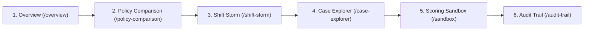

# SignalGate — Operational Runbook & Offline Demo Guide

**Document Version:** 1.0.0  
**Phase:** Phase 9 (End-to-End Integration & Offline Demo Reliability)  
**Status:** `SYNTHETIC_SMOKE_ONLY`  
**Target Platform:** Windows 10/11 (PowerShell / Command Prompt)

---

## 1. Quick Launch Procedures

SignalGate is architected to operate with **zero network connectivity**. All models, calibration coefficients, pre-rendered replay streams, and evaluation benchmarks reside locally in the repository.

### 1.1 One-Click Windows Launcher (Recommended)
From Windows Explorer or Command Prompt:
```cmd
scripts\start_demo.bat
```
The script performs the following automated steps:
1. Verifies that `python` and `npm` exist in `PATH`.
2. Executes `python scripts\validate_artifacts.py` to confirm cryptographic hashes and artifact integrity.
3. Checks if port `8000` or `5173` is already in use to prevent duplicate orphan processes.
4. Spawns two independent command windows:
   - **SignalGate Backend API (FastAPI :8000)**
   - **SignalGate Frontend (Vite :5173)**
5. Displays service endpoints and shutdown instructions.

---

### 1.2 Two-Terminal Manual Launch Procedure

If you prefer explicit control in existing terminal tabs:

#### Step 1: Launch Backend API
Open **Terminal 1** in the repository root (`C:\Users\arpit\Desktop\project`):
```powershell
python -m uvicorn backend.app.main:app --host 127.0.0.1 --port 8000
```
- Wait until you see: `Application startup complete.`
- Test health in a browser or PowerShell:
  ```powershell
  curl http://127.0.0.1:8000/api/health
  # Expected Response: {"service_name":"SignalGate API","version":"2.1.0","status":"HEALTHY","timestamp":"..."}
  ```

#### Step 2: Launch Frontend Development Server
Open **Terminal 2** in the `frontend` subfolder:
```powershell
cd C:\Users\arpit\Desktop\project\frontend
npm run dev -- --host 127.0.0.1 --port 5173
```
- Wait until you see: `VITE v5.4.21  ready in ... ms` $\rightarrow$ `➜  Local: http://127.0.0.1:5173/`

#### Step 3: Access Dashboard
Open your web browser and navigate to:
```
http://127.0.0.1:5173/overview
```

---

## 2. Service Endpoints & Health Verification

| Service / Resource | Local URL | Expected Status / Schema |
| :--- | :--- | :--- |
| **Frontend Dashboard** | `http://127.0.0.1:5173/overview` | HTTP 200 OK — Full React 18 SPA |
| **Backend Health** | `http://127.0.0.1:8000/api/health` | `{"status": "HEALTHY", "version": "2.1.0"}` |
| **System Readiness** | `http://127.0.0.1:8000/api/status` | `{"overall_status": "READY", "evidence_status": "SYNTHETIC_SMOKE_ONLY"}` |
| **Overview Telemetry** | `http://127.0.0.1:8000/api/overview` | `{"dataset_status": "SYNTHETIC_SMOKE_ONLY", "evaluation_status": "COMPLETE"}` |
| **Interactive API Docs** | `http://127.0.0.1:8000/docs` | Swagger UI documentation of all 11 endpoints |
| **OpenAPI Specification**| `http://127.0.0.1:8000/openapi.json`| OpenAPI 3.1 JSON contract |

---

## 3. Curated 3-to-5 Minute Demonstration Walkthrough

This scripted demonstration highlights the key scientific, architectural, and visual capabilities of SignalGate.



### Minute 1: Operational Cockpit & The Signal Core (`/overview`)
1. **Navigate to:** `http://127.0.0.1:5173/overview`
2. **Observe Key Metrics:**
   - Denominator: $N = 2,000$ test partition transactions.
   - Total Available Fraud: $111$ fraud cases ($5.55\%$ test prevalence).
   - Review Capacity: $B = 130$ cases ($6.525\%$ capacity, matching $1.5\times$ training prevalence).
   - Baseline Recall: $9.01\%$ ($10/111$ fraud caught).
3. **Inspect Outcome Distribution Bar:**
   - `FRAUD_ALERT` (R1): $11$ cases ($0.55\%$)
   - `MANUAL_REVIEW` (R2/R3): $119$ cases ($5.95\%$)
   - `ROUTINE` (R5): $896$ cases ($44.80\%$)
   - `HELD / DEFERRED` (R6): $974$ cases ($48.70\%$)
   - *Key Talking Point:* Point out how the $11$ alerts $+ 119$ reviews $= 130$ total admitted escalations, matching the analyst capacity quota exactly.
4. **Signal Core Radar:**
   - Click on the radar nodes ("Stage 1: Feature Ingestion", "Stage 2: Core Estimators", "Stage 3: Decision Lanes").
   - Notice the telemetry inspection panel sliding open with rule thresholds and case counts.
5. **Theme Toggle:**
   - Click the Sun icon in the top header. Observe the transition to the crisp light theme with soft purple active navigation boxes. Refresh the page to demonstrate `localStorage` persistence.

---

### Minute 2: Matched-Workload Policy Comparison (`/policy-comparison`)
1. **Navigate to:** `http://127.0.0.1:5173/policy-comparison`
2. **Inspect Matched Capacity:**
   - Highlight the 5 comparative policies: B1 (Fixed Threshold), B2 (Top-B Risk), B3a (Confidence Deferral), B4 (Random Control), and SignalGate.
   - Point out that under the $1.5\times$ capacity budget ($130$ reviews), SignalGate matches B2 Top-B Risk with identical recall ($9.01\%$) and precision ($7.69\%$).
3. **Inspect the Paired Bootstrap CI Notice:**
   - 95% Confidence Interval is `[-2.75 pp, +2.75 pp]`.
   - Conclusive Gain Flag: `false`.
   - *Key Talking Point:* Explain scientific integrity—SignalGate does not invent or overclaim superiority on development fixtures. Its operational value is structured deferral (974 unreviewed transactions quarantined instead of passed silently).
4. **Budget Multiplier Sweep:**
   - Click through budget choices: `1.0x` ($87$ reviews), `2.0x` ($174$ reviews), and `3.0x` ($261$ reviews). Notice the discrete bar updates derived from genuine pre-computed sweep records.

---

### Minute 3: Shift Storm Replay (`/shift-storm`)
1. **Navigate to:** `http://127.0.0.1:5173/shift-storm`
2. **Replay Transport:**
   - Click **Run Replay**. Watch rows stream sequentially at 1x speed.
   - Click **2x** or **5x** to accelerate replay.
   - Click **Pause**, then use the **Step Forward (→)** and **Step Back (←)** buttons.
   - Drag the scrub slider to frame $1,500$.
3. **Row Telemetry & Dossier:**
   - Click any row in the streaming grid (e.g. Row 1, Case `2995000`).
   - Observe the detail dossier updating instantly with calibrated risk $p$, disagreement $u_2$, and transaction features ($TransactionAmt$, $ProductCD$, $card4$).

---

### Minute 4: Scoring Sandbox & Leakage Guardrails (`/sandbox`)
1. **Navigate to:** `http://127.0.0.1:5173/sandbox`
2. **Preset Payloads:**
   - Click **Clean Routine Transaction**: Notice low amount ($45.00$). Click **Score Payload** $\rightarrow$ Action returns `ROUTINE` ($R5$) with latency $< 15\text{ms}$.
   - Click **High-Risk Alert Candidate**: Notice high amount ($980.50$). Click **Score Payload** $\rightarrow$ Action returns `FRAUD_ALERT` ($R1$) with calibrated risk $p \ge 0.0847$.
   - Click **Disagreement Edge Case**: Notice conflicting features. Click **Score Payload** $\rightarrow$ Action returns `MANUAL_REVIEW` ($R3$) due to elevated disagreement $u_2 \ge 0.5268$.
3. **Demonstrate Leakage Protection:**
   - In the JSON editor, type: `"isFraud": 1` or `"TransactionID": "2995000"`.
   - Observe immediate client-side validation error.
   - Press Enter to submit anyway $\rightarrow$ Backend returns HTTP 422: `LEAKAGE VIOLATION: Forbidden field detected and rejected`.

---

### Minute 5: Audit Trail & Export (`/audit-trail`)
1. **Navigate to:** `http://127.0.0.1:5173/audit-trail`
2. **Audit Ledger:**
   - View recorded decision records, including the real-time transactions scored during Minute 4 in the sandbox.
   - Click **Inspect** on any row to open the raw JSON record with cryptographic SHA-256 hash.
3. **Export Actions:**
   - Click **Export JSONL** $\rightarrow$ Downloads `audit_export.jsonl`.
   - Click **Export CSV** $\rightarrow$ Downloads `audit_export.csv`.

---

## 4. Offline Verification Test (Air-Gap Test)

To prove that the platform is 100% self-contained:
1. Disconnect your machine from Wi-Fi or unplug your Ethernet cable.
2. Run `python scripts\validate_artifacts.py` $\rightarrow$ Confirms all artifacts verify with exit code `0`.
3. Open `http://127.0.0.1:5173/overview` $\rightarrow$ Dashboard loads, 3D radar renders, charts display data.
4. Open `/sandbox` and score a transaction $\rightarrow$ Inference executes locally in $< 15\text{ms}$.
5. Reconnect internet when finished.

---

## 5. Comprehensive Quality & Test Commands

Run all verification suites from their respective roots:

### 5.1 Artifact Integrity Validator
```powershell
python scripts\validate_artifacts.py
# Exit Code: 0
```

### 5.2 Backend Pytest Suite
```powershell
python -m pytest tests/
# 108 passed in ~11s (Exit Code: 0)
```

### 5.3 Frontend TypeScript Verification
```powershell
cd frontend
npx tsc --noEmit
# Exit Code: 0 (0 errors)
```

### 5.4 Frontend Vitest Unit Suite
```powershell
cd frontend
npm test -- --run
# 3/3 passed (Exit Code: 0)
```

### 5.5 Production Bundle Compilation
```powershell
cd frontend
npm run build
# 2,432 modules transformed in ~14s (Exit Code: 0)
```

---

## 6. Troubleshooting & Diagnostics

### Problem: Port 8000 is already in use
- **Symptom:** Backend reports `[Errno 10048] error while attempting to bind on address ('127.0.0.1', 8000)`.
- **Fix:** In PowerShell, find and terminate the process holding port 8000:
  ```powershell
  $port8000 = (Get-NetTCPConnection -LocalPort 8000 -ErrorAction SilentlyContinue).OwningProcess
  if ($port8000) { Stop-Process -Id $port8000 -Force }
  ```

### Problem: Port 5173 is already in use
- **Symptom:** Vite starts on port 5174 instead of 5173.
- **Fix:** Terminate existing Node process or specify `--port 5173`:
  ```powershell
  $port5173 = (Get-NetTCPConnection -LocalPort 5173 -ErrorAction SilentlyContinue).OwningProcess
  if ($port5173) { Stop-Process -Id $port5173 -Force }
  ```

### Problem: Browser automation tool reports timeout
- **Symptom:** `open_browser_url: action timed out after 20000ms`.
- **Reason:** In virtualized or headless Windows environments, sandboxed browser launches may exceed default timeout windows.
- **Workaround:** Open `http://127.0.0.1:5173/overview` directly in any installed browser (Chrome, Edge, Firefox). The platform is fully compatible with all modern evergreen browsers.

---

## 7. Graceful Shutdown Procedure

To cleanly terminate all SignalGate services:
1. In the backend terminal window (`SignalGate Backend API`), press `Ctrl+C` or close the window.
2. In the frontend terminal window (`SignalGate Frontend`), press `Ctrl+C` (and answer `Y` if prompted) or close the window.
3. Alternatively, to safely terminate only the specific processes listening on demo ports 8000 and 5173 without affecting any unrelated Python or Node applications:
   ```cmd
   scripts\stop_demo.bat
   ```
   Or via PowerShell:
   ```powershell
   $pids = (Get-NetTCPConnection -LocalPort 8000, 5173 -State Listen -ErrorAction SilentlyContinue).OwningProcess | Select-Object -Unique
   if ($pids) { Stop-Process -Id $pids -Force }
   ```

